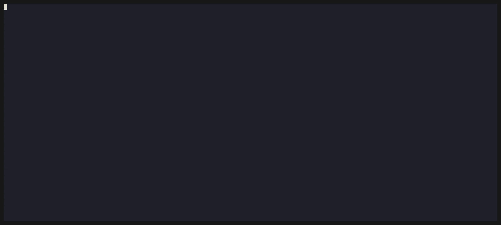

# synopsis.nvim

Get up to speed in an unfamiliar codebase without leaving
[Telescope](https://github.com/nvim-telescope/telescope.nvim). synopsis adds two things to
Telescope's file and grep pickers:

- **A summary of the previewed file**, in a pane above the results: what the file does, what to
  watch out for, and the files it works with. It is written by a language model the first time
  you stop on a file, then cached.
- **A chat about the repo**, beside the picker. The model searches and reads the code to answer,
  and cites the lines it used. Tab through the citations and Telescope's preview shows each one.


`softmax.py` already has a summary, so it appears immediately; `related.lua` gets one after a
one-second pause.



Ctrl-Space opens the chat beside the picker. The answer took 10 s, shown as it happened. Tab
moves through the citations, and the preview, the selected result and the summary follow.

## Features

- Summaries you can read in a few seconds, pitched at your background if you describe it.
- Answers that cite `path:line`, with the cited code block highlighted in the preview.
- Telescope stays open beside the chat: Ctrl-Space switches between them.
- One conversation per repo for the whole Neovim session.
- Any OpenAI-compatible endpoint, including a local llama.cpp or Ollama server.
- Nothing is sent until you allow the repo, and secret-looking files are never sent.
- Cheap: about $0.00014 per summary and $0.003 per answer with the default model.

## Requirements

- Neovim 0.12+
- [telescope.nvim](https://github.com/nvim-telescope/telescope.nvim) and
  [plenary.nvim](https://github.com/nvim-lua/plenary.nvim)
- `curl` and [ripgrep](https://github.com/BurntSushi/ripgrep)
- An API key for the model you use, or a local model server
- Optional: [markview.nvim](https://github.com/OXY2DEV/markview.nvim) and
  [snacks.nvim](https://github.com/folke/snacks.nvim) render markdown and LaTeX in answers;
  Tree-sitter parsers for your languages improve the repo map and the highlighted blocks.

## Installation

With [lazy.nvim](https://github.com/folke/lazy.nvim):

```lua
{
  'aaholmes/synopsis.nvim',
  dependencies = { 'nvim-lua/plenary.nvim', 'nvim-telescope/telescope.nvim' },
  opts = {},
}
```

With Neovim's built-in `vim.pack`:

```lua
vim.pack.add {
  'https://github.com/nvim-lua/plenary.nvim',
  'https://github.com/nvim-telescope/telescope.nvim',
  'https://github.com/aaholmes/synopsis.nvim',
}
require('synopsis').setup()
```

The default model, GPT-6 Luna, reads its key from `OPENAI_API_KEY`.

## Setup

synopsis registers a Telescope layout, `synopsis`: Telescope's `horizontal` layout with room for
the summary pane, taking the same `layout_config` options. Use it for the pickers that should
show summaries:

```lua
require('telescope').setup {
  pickers = {
    find_files = { layout_strategy = 'synopsis' },
    live_grep = { layout_strategy = 'synopsis' },
  },
}
```

or for every picker with `defaults = { layout_strategy = 'synopsis' }`. To ask about the repo
outside Telescope, map `:SynopsisAsk`:

```lua
vim.keymap.set('n', '<leader>sa', '<cmd>SynopsisAsk<cr>', { desc = 'Ask about this repo' })
```

## Usage

### Summaries

Open a picker with the `synopsis` layout and move through the files. A cached summary appears
immediately; for a file without one, a summary is written after you stay on it for a second. A
summary is rewritten when the file, the prompt, your background or the model changes.

The first time a repo would be sent, the pane asks: Ctrl-a allows the repo, Ctrl-o turns
summaries off for it. `:SynopsisAllow` and `:SynopsisDeny` change the answer later.

### Chat

Press Ctrl-Space on a file in the picker. On a screen at least 180 columns wide, the chat opens
in a column on the right and the picker stays open; on narrower screens it opens on its own and
the picker comes back when you close it.

- Type in the input panel and press Enter. While the model works, its searches and reads appear
  as muted lines.
- Each answer selects its first citation. Tab and Shift-Tab move through the citations; the
  preview highlights the cited lines, or the function, loop or statement that starts on a cited
  line.
- The picker follows the citation: its file is selected in the results, clearing the prompt if
  it is not listed, and the summary pane shows it.
- Ctrl-Space goes back to the picker with the same file previewed, and back again to the chat.
- Enter with nothing typed opens the selected citation, as do Ctrl-x, Ctrl-v and Ctrl-t (split,
  vertical split, tab) and a click on the preview.

The conversation lasts until you quit Neovim. Ctrl-Space on another file continues it, and Ctrl-n
starts a new one.

## Keys

In the picker's prompt (Insert and Normal mode):

| Key | Action |
|---|---|
| `<C-Space>` | Open the chat about the selected file, or go back to it |
| `<C-e>` / `<C-y>` | Scroll the summary down / up |
| `<C-a>` / `<C-o>` | Allow the repo to be sent / turn summaries off for it |

In the chat's input panel:

| Key | Action |
|---|---|
| `<CR>` | Send the question; with nothing typed, open the selected citation |
| `<Tab>` / `<S-Tab>` | Select the next / previous citation |
| `<C-x>` / `<C-v>` / `<C-t>` | Open the selected citation in a split / vertical split / tab |
| `<C-Space>` | Back to the picker |
| `<C-n>` | Start a new conversation |
| `<C-c>`, or `q` / `<Esc>` in Normal mode | Close the chat, cancelling a running answer |
| `gl` (Normal mode) | List every cited location in Telescope |

With the mouse, click a citation to select it, or click between the chat and the picker. Every
key can be changed or turned off in `setup` (see below).

## Configuration

The defaults:

```lua
require('synopsis').setup {
  -- Any OpenAI-compatible chat endpoint. api_key_env = false sends no key (a local server).
  llm = {
    url = 'https://api.openai.com',
    chat_path = '/v1/chat/completions',
    model = 'gpt-6-luna',
    api_key_env = 'OPENAI_API_KEY',
    params = { reasoning_effort = 'none' }, -- added to the request body as given
    timeout_ms = 30000,
    cache = 'auto',          -- mark the prompt start a repo's files share for OpenAI's cache
    prompt_cache_key = true, -- send a hash of the repo root as the cache key
  },
  background = '~/.config/butwhy/background.md', -- who the summaries are written for
  consent = 'ask',        -- or 'always': send without asking
  delay_ms = 1000,        -- how long to stay on a file before a summary is requested
  max_bytes = 100 * 1024, -- larger files are never sent
  exclude = { '.env', '.env.*', '*.pem', '*.key', '*secret*', '*.lock', '*-lock.json' },
  max_concurrent = 3,
  height = 0.6,           -- the pane: below 1, a fraction of the left column; else lines
  keymaps = { scroll_up = '<C-y>', scroll_down = '<C-e>', allow = '<C-a>', deny = '<C-o>', ask = '<C-Space>' },
  ask = {
    max_rounds = 10,           -- turns of tool calls before the model must answer
    max_map_chars = 150000,    -- past this, files are listed in the repo map by path only
    render = true,             -- render answers with markview.nvim and snacks.nvim, if installed
    preview = true,            -- a preview pane when the chat opens on its own
    preview_min_columns = 120, -- narrower screens get no preview pane
    side_min_columns = 180,    -- from this width, the chat opens beside the picker
    keymaps = {
      close = { 'q', '<Esc>' }, open = '<CR>', locations = 'gl', new_chat = '<C-n>',
      next_citation = '<Tab>', prev_citation = '<S-Tab>', picker = '<C-Space>',
      open_split = '<C-x>', open_vsplit = '<C-v>', open_tab = '<C-t>',
    },
  },
}
```

A local [llama.cpp](https://github.com/ggml-org/llama.cpp) server, with nothing leaving your
machine:

```lua
require('synopsis').setup {
  llm = { url = 'http://127.0.0.1:8080', model = 'local', api_key_env = false, params = {} },
  consent = 'always',
}
```

### Your background

Summaries are written for the reader described in the `background` file (shared with
[butwhy.nvim](https://github.com/aaholmes/butwhy.nvim)). Topics work better than job titles:

```markdown
## Strong
- Python, NumPy, PyTorch

## New to me
- Lua, Neovim's plugin API
```

### Highlights

| Group | Used for | Default |
|---|---|---|
| `SynopsisLabel` | Labels such as "Watch out:" in the pane | `@markup.strong` |
| `SynopsisCode` | Paths and identifiers in the pane | `@markup.raw` |
| `SynopsisBullet` | Note bullets in the pane | `@markup.list` |
| `SynopsisMessage` | Status lines in the pane | `Comment` |
| `SynopsisQuestion` | Questions in the chat | `Function`'s colour, bold |
| `SynopsisProgress`, `SynopsisMeta`, `SynopsisHint` | The chat's progress lines, footers and hints | `Comment` |
| `SynopsisCited` | Cited lines in the preview | `Visual` |
| `SynopsisLink` | The selected citation in the chat | `IncSearch` |

After each change to the chat, synopsis fires `User SynopsisAnswerRendered` with `{ buf, win }`
for other renderers; `ask.render = false` turns off the built-in rendering.

## Privacy and cost

A summary request sends your background, the first 150 lines of the README, the file list (up
to 400 paths) and the file. A question sends a map of the repo (paths, leading comments and
definition names) and whatever the model searches for or reads. Files matching `exclude`, over
`max_bytes` or binary are never sent, searched or read.

With GPT-6 Luna ($0.10 / $0.50 per million tokens in / out, measured 2026-11-08), a summary
costs a median of $0.00014 and an answer $0.0027 (8 tool calls, 10 s). Summaries are cached
under `~/.cache/nvim/synopsis`, never in the repo; `:SynopsisClear` deletes the current repo's.

## How it works

The chat's model gets a map of the repo built without a model, from each file's leading comment
and the names it defines, plus tools to search (ripgrep) and read the code. On 80 questions
about 8 repos, its answers contained 0.74 [95% CI 0.69, 0.79] of the facts a correct answer
needs, compared with 0.36 for answers from file summaries alone. The architecture, the design
choices and the evaluations behind them are in [docs/design.md](docs/design.md).

## Tests

```sh
tests/run.sh
```

They run headless with a fake chat endpoint, so they need no network or API key.

## License

MIT
